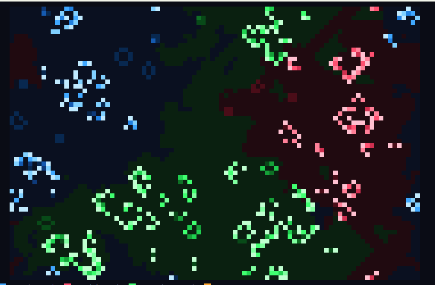

At its core, this project is a playful meditation on emergence: from a few simple local rules — count your neighbors, inherit the majority team — complex patterns, loyalties, and conflicts arise with no central designer. Adding "teams" turns neutral cellular automata into agents with identity, while the "contested" state captures the ambiguity of ties where no single side wins. Most poetically, territory persists after death, so the board becomes a palimpsest of past battles — a landscape scarred by history rather than wiped clean. In short, it's a small allegory about emergence, tribalism, and memory, reminding us that rivalries and borders can crystallize from purely local interactions, and that even a deterministic world yields an endlessly unfolding, unpredictable war.

